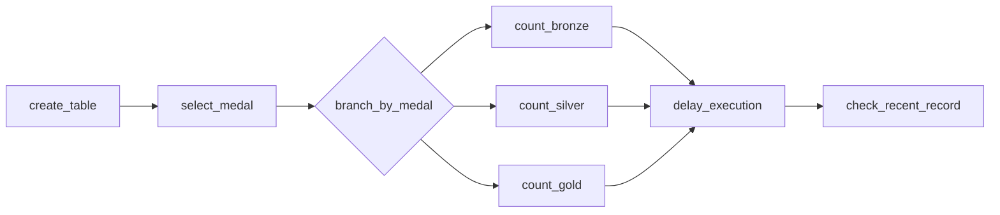
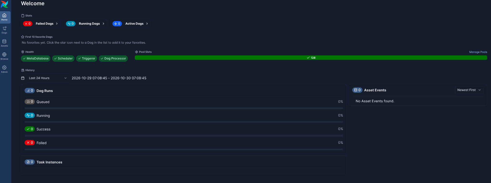
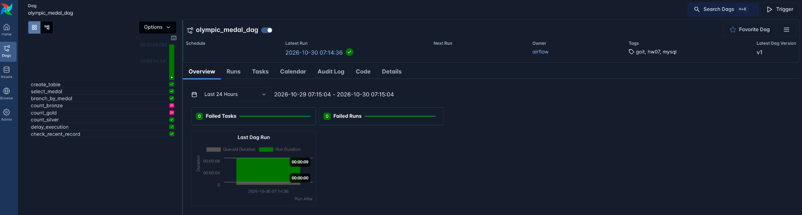
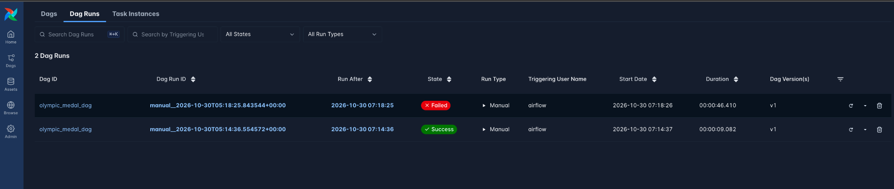
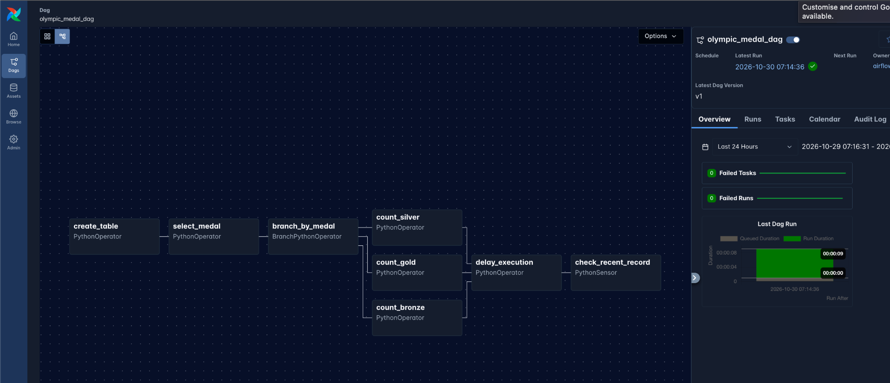
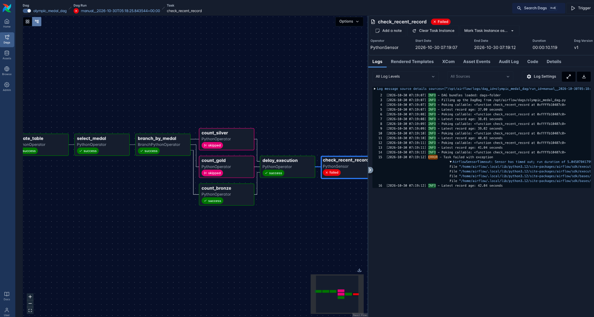
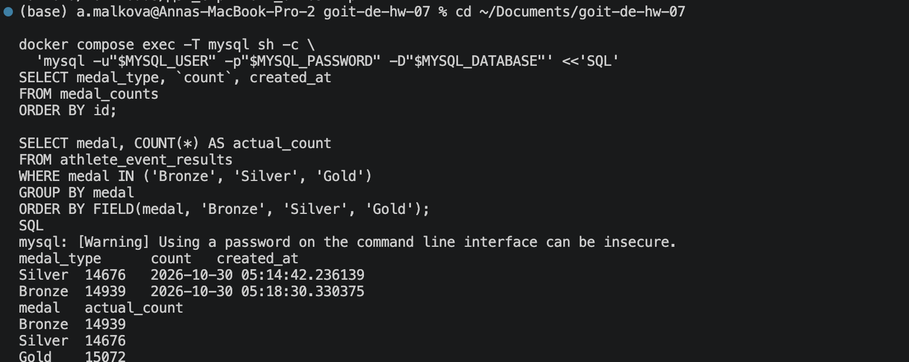

# ДЗ7 — Apache Airflow: підрахунок олімпійських медалей

**Курс:** GoIT / Neoversity — Data Engineering  
**Тема 7:** Apache Airflow  
**Авторка:** Анна Малькова  
**Репозиторій:** `goit-de-hw-07`

## Мета роботи

Побудувати в Apache Airflow DAG для роботи з MySQL, який створює таблицю результатів, випадково вибирає тип олімпійської медалі (`Bronze`, `Silver` або `Gold`), запускає лише відповідну гілку підрахунку, записує кількість медалей до MySQL, виконує затримку та за допомогою сенсора перевіряє, чи найновіший запис не старший за 30 секунд.

Передбачено два сценарії перевірки: **успішний запуск із затримкою 2 секунди** та **навмисно невдалий запуск із затримкою 35 секунд**.

## Технології

- **Apache Airflow 3.1.7** — оркестрація завдань, розгалуження та сенсор;
- **MySQL 8.4** — зберігання вихідних даних і результатів агрегації;
- **Python** і **PyMySQL** — логіка обробки та підключення до бази;
- **Docker / Docker Compose** — локальний запуск сервісів.

Вебінтерфейс Airflow доступний на `http://localhost:8080`, MySQL — на порту `3307` хост-машини. Усередині Docker-мережі Airflow підключається до MySQL за іменем сервісу `mysql` (порт `3306`).

## Вихідні дані

Джерело: [GoIT — athlete_event_results.csv](https://ftp.goit.study/neoversity/athlete_event_results.csv).

Файл містить результати олімпійських виступів, зокрема поле `medal`. Дані імпортовано до таблиці **`olympic_dataset.athlete_event_results`**.

| Показник | Кількість записів |
|---|---:|
| Усього записів | 316 834 |
| Bronze | 14 939 |
| Silver | 14 676 |
| Gold | 15 072 |

Підрахунок здійснюється **за рядками таблиці**, для яких `medal` дорівнює відповідному значенню. CSV-файл не зберігається в Git-репозиторії: його можна завантажити з указаного джерела.

## Структура проєкту

```text
goit-de-hw-07/
├── dags/
│   └── olympic_medal_dag.py
├── sql/
│   └── import_athlete_event_results.sql
├── screenshots/
│   ├── 01_airflow_dashboard.png
│   ├── 02_dag_success.png
│   ├── 03_success_failed_runs.png
│   ├── 04_dag_graph.png
│   ├── 05_failed_sensor_logs.png
│   └── 06_mysql_medal_counts.png
├── Dockerfile
├── docker-compose.yml
├── .gitignore
└── README.md
```

Під час локального запуску додатково створюються `.env` з паролями та `data/athlete_event_results.csv`. Вони ігноруються Git.

## Логіка DAG

Ідентифікатор: **`olympic_medal_dag`**. DAG запускається вручну (`schedule=None`), без автоматичного планування.



1. **`create_table`** — створює за потреби таблицю `medal_counts` через `CREATE TABLE IF NOT EXISTS`. Поля: `id` (автоінкрементний первинний ключ), `medal_type`, `count`, `created_at`.
2. **`select_medal`** — випадково вибирає `Bronze`, `Silver` або `Gold`.
3. **`branch_by_medal`** — отримує вибрану медаль через XCom та активує відповідну гілку.
4. **`count_bronze` / `count_silver` / `count_gold`** — підраховує записи у вихідній таблиці з потрібною медаллю та додає результат до `medal_counts` разом із часовою міткою UTC.
5. **`delay_execution`** — затримує виконання через `time.sleep()`. Кількість секунд задається параметром `delay_seconds` у конфігурації запуску DAG; стандартне значення — `2`.
6. **`check_recent_record`** — `PythonSensor`, який перевіряє вік найновішого запису у `medal_counts`. Успіх: вік не перевищує **30 секунд**; інакше сенсор продовжує перевірки до тайм-ауту.

Оскільки дві невибрані гілки отримують статус `skipped`, для `delay_execution` використано правило **`none_failed_min_one_success`** — затримка запускається після успіху будь-якої однієї гілки.

## Локальний запуск

### 1. Підготувати налаштування

Потрібен установлений та запущений Docker Desktop.

```bash
# Виконувати з кореня репозиторію.
cat > .env <<EOF
MYSQL_ROOT_PASSWORD=$(openssl rand -hex 16)
MYSQL_PASSWORD=$(openssl rand -hex 16)
EOF
```

Файл `.env` містить паролі та **не повинен потрапляти до GitHub**.

### 2. Запустити MySQL

```bash
docker compose up -d mysql
docker compose ps
```

### 3. Завантажити та імпортувати датасет

```bash
mkdir -p data
curl -fL --retry 3 \
  https://ftp.goit.study/neoversity/athlete_event_results.csv \
  -o data/athlete_event_results.csv

docker compose cp \
  data/athlete_event_results.csv \
  mysql:/var/lib/mysql-files/athlete_event_results.csv

docker compose exec -T mysql sh -c \
  'mysql -uroot -p"$MYSQL_ROOT_PASSWORD" "$MYSQL_DATABASE"' \
  < sql/import_athlete_event_results.sql
```

**Примітка:** SQL-скрипт містить `TRUNCATE TABLE athlete_event_results`, тобто повторний запуск очищає та знову імпортує **вихідну** таблицю.

### 4. Запустити Airflow

```bash
docker compose up -d --build airflow
```

У конфігурації цього проєкту DAG-файли **не монтуються безпосередньо з `Documents`**, оскільки Docker Desktop на macOS може блокувати таке монтування. Для оновлення DAG використовується явне копіювання:

```bash
docker compose cp \
  dags/olympic_medal_dag.py \
  airflow:/opt/airflow/dags/olympic_medal_dag.py

docker compose restart airflow

docker compose exec -T airflow airflow dags list
```

Відкрити `http://localhost:8080`. Для першого входу використати користувача `admin`; згенерований локальний пароль можна переглянути командою:

```bash
docker compose exec -T airflow \
  cat /opt/airflow/simple_auth_manager_passwords.json.generated
```

### 5. Запустити перевірки

Увімкнути DAG та створити успішний запуск:

```bash
docker compose exec -T airflow \
  airflow dags unpause -y olympic_medal_dag

docker compose exec -T airflow \
  airflow dags trigger olympic_medal_dag \
  --conf '{"delay_seconds":2}'
```

Для негативного сценарію:

```bash
docker compose exec -T airflow \
  airflow dags trigger olympic_medal_dag \
  --conf '{"delay_seconds":35}'
```

Статуси доступні у вебінтерфейсі Airflow (`Dags` → `olympic_medal_dag` → `Runs`).

## Результати тестування

| Перевірка | Очікувано | Фактично |
|---|---|---|
| Затримка `2` с | `success` | **Success**, тривалість DAG 9,082 с |
| Затримка `35` с | `failed` | **Failed**, тривалість DAG 46,410 с |
| Вибір гілки | Виконано одну з трьох | Перший запуск — `count_silver`; другий — `count_bronze` |
| Запис у MySQL | Кількість відповідає джерелу | Silver — 14 676; Bronze — 14 939 |
| Перевірка свіжості | Відхилення після 30 с | У логах сенсора — 37,00–42,04 с; `AirflowSensorTimeout` |

Другий запуск є **навмисно негативним тестом**, а не неочікуваною помилкою: сенсор коректно відхиляє запис, старший за 30 секунд.

SQL-перевірка записів Airflow:

```sql
SELECT medal_type, `count`, created_at
FROM medal_counts
ORDER BY id;
```

Фактичні записи:

| medal_type | count | created_at (UTC) |
|---|---:|---|
| Silver | 14 676 | 2026-10-30 05:14:42.236139 |
| Bronze | 14 939 | 2026-10-30 05:18:30.330375 |

## Скриншоти виконання

### 1. Головна сторінка Airflow

Усі основні компоненти Airflow працюють.



### 2. Успішний запуск DAG

Успішно виконано створення таблиці, випадковий вибір, гілку `count_silver`, затримку та сенсор; інші дві гілки пропущено.



### 3. Порівняння двох запусків

У списку запусків одночасно видно **Success** та очікуваний **Failed**.



### 4. Граф залежностей DAG

Видно три альтернативні гілки підрахунку та їх об'єднання перед затримкою і сенсором.



### 5. Негативний сценарій — логи сенсора

Після затримки 35 секунд `check_recent_record` фіксує вік запису понад 30 секунд та завершується зі статусом **failed**.



### 6. Результати MySQL

Значення, записані Airflow, збігаються з контрольними підрахунками з вихідної таблиці.



## Висновок

Реалізовано й перевірено всі етапи завдання: створення таблиці, генерацію випадкового значення, розгалуження, підрахунок і запис результатів, затримку та сенсор свіжості запису. Позитивний і негативний сценарії підтверджено станами запусків Airflow, логами сенсора та даними MySQL.
